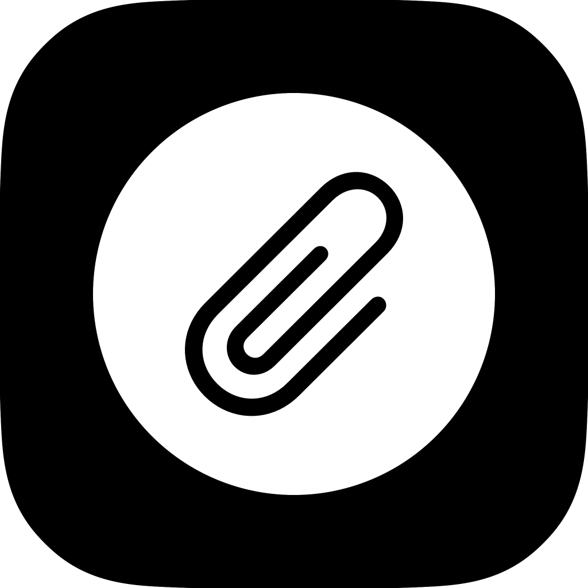

<p align="center">
  
</p>

<h1 align="center">Clipper</h1>

<p align="center">
  A private, on-device clipboard manager for iOS, delivered as a custom keyboard.<br/>
  Remembers what you copy, lets you pin what matters, and pastes it anywhere with one tap.
</p>

<p align="center">
  
  
  
  
</p>

---

## Overview

iOS has no clipboard history. Copy something new and the old value is gone. Clipper fixes that without a server, an account, or analytics: everything stays in an App Group container on the device.

The app ships as four targets that share one storage layer:

| Target            | Kind             | What it does                                                        |
|-------------------|------------------|---------------------------------------------------------------------|
| `Clipper`         | iOS app          | History and pins, settings, onboarding, Siri and Shortcuts intents  |
| `ClipperKeyboard` | Custom keyboard  | Clipboard-only keyboard: tap to insert, long-press for variants     |
| `ClipperShare`    | Share extension  | "Save to Clipper" from any share sheet                              |
| `ClipperTests`    | Unit tests       | Store rules, kind detection, text transforms                        |

## Features

- **Clipboard history.** The last 10 copies (50 with Pro), deduplicated, newest first.
- **Pins.** Keep snippets forever and reorder them by drag in the app.
- **Keyboard insert.** Switch to the Clipper keyboard, tap a chip, and it is typed into any text field. Optionally jumps back to your previous keyboard after inserting.
- **Smart kinds.** Each clip is classified as text, link, email, phone or one-time code, using `NSDataDetector` plus a small rule set. Pro users get kind-aware actions: open a link, compose an email, place a call.
- **Insert variants.** Long-press a chip to insert it in UPPERCASE or lowercase.
- **Capture from anywhere.** The keyboard, the app, the share sheet, Back Tap, the Action Button and Siri can all record a clip.
- **Siri and Shortcuts.** Three App Intents: Save Clipboard, Save Text (with an optional pin), and Get Clips (feeds clips into other shortcuts).
- **No network.** No analytics SDK, no iCloud, no third-party dependencies. The only entitlement is the App Group.
- **Clipper Pro.** A single non-consumable in-app purchase handled with StoreKit 2.

<!--
## Screenshots

| History | Keyboard | Share sheet |
|---|---|---|
|  |  |  |
-->

## How it works

### Capture

iOS does not let apps observe the clipboard in the background, so Clipper reads it at well-defined moments:

| Trigger                           | Process          | Requirement                              |
|-----------------------------------|------------------|------------------------------------------|
| Keyboard opens                    | Keyboard         | **Allow Full Access** for the keyboard   |
| App comes to the foreground       | App              | None                                     |
| "Save Clipboard" shortcut runs    | App Intent       | Bind to Back Tap or the Action Button    |
| Share › Clipper on text or a link | Share extension  | None                                     |

`ClipboardCapture` compares `UIPasteboard.changeCount` with the last value seen before touching the contents, so each copy is read at most once. The change count is persisted *before* the read, which means a denied "would like to paste" prompt is never shown twice for the same copy.

### Storage and sync between processes

- All clips live in a single JSON file (`clips.json`) inside the App Group container, written atomically with file protection.
- `ClipStore` is a `@MainActor @Observable` class that owns the list, enforces tier limits, and writes on every mutation.
- Processes cannot share memory, so after each write the store posts a **Darwin notification**. The other processes observe it and reload from disk. No payload, no race on partial state.
- The Pro flag is cached in shared `UserDefaults` so the keyboard and share extension never need to talk to StoreKit.

### Keyboard design

The keyboard is clipboard-only: two tabs (Recent, Pinned), chip rows, and a globe key. There is no letter row by design. Inserting a chip can hand control back to the previous keyboard automatically, so the typical flow is *globe › tap › back to typing* in under a second. The extension has been profiled in Instruments at roughly 12 MB resident with no per-cycle growth, well under the keyboard memory ceiling.

## Architecture

```
Shared/              Compiled into every target
├─ ClipItem          Model + ClipKind, tolerant Codable for migrations
├─ ClipStore         Source of truth: history cap, pins, ordering, persistence
├─ ClipFileStorage   JSON read/write in the App Group container
├─ ClipboardCapture  Read-once pasteboard capture
├─ ClipKindDetector  text / link / email / phone / code classification
├─ TextTransforms    Insert variants (uppercase, lowercase, trimmed, first line)
├─ Entitlements      Free vs Pro limits, cached Pro flag
├─ DarwinNotifier    Cross-process change broadcast
└─ AppGroup          Identifiers, shared defaults, typed settings

Clipper/             App: SwiftUI views, onboarding, settings, paywall
├─ Intents/          App Intents + AppShortcutsProvider
├─ ProStore          StoreKit 2 purchase, restore and entitlement refresh
└─ Clipper.storekit  Local StoreKit configuration for simulator testing

ClipperKeyboard/     Keyboard extension (UIInputViewController hosting SwiftUI)
ClipperShare/        Share extension
ClipperTests/        22 unit tests (XCTest)
```

Design rules that shaped the code:

- **Shared code is Foundation and UIKit only.** Both extensions are built with `APPLICATION_EXTENSION_API_ONLY`, so nothing in `Shared/` may depend on app-only APIs.
- **One place for limits.** Tier numbers live in `Limits` and nowhere else.
- **Graceful degradation.** If the App Group is misconfigured, storage falls back to the process's own Documents directory and settings fall back to standard defaults. The app keeps working; data just stops being shared.
- **Swift 6 strict concurrency.** The store and capture paths are `@MainActor`; models are `Sendable`.

## Tech stack

- Swift 6, SwiftUI, Observation framework
- App Intents and `AppShortcutsProvider`
- StoreKit 2
- App Groups, Darwin notifications, `NSDataDetector`
- XcodeGen for project generation, XCTest for unit tests

## Getting started

### Requirements

- Xcode 16 or newer
- iOS 17.0+ deployment target
- [XcodeGen](https://github.com/yonaskolb/XcodeGen)

### Build

```sh
brew install xcodegen
xcodegen generate
open Clipper.xcodeproj
```

The `.xcodeproj` is generated and git-ignored. `project.yml` is the source of truth for targets, entitlements and Info.plist values.

### Command line

```sh
# Build
xcodebuild -project Clipper.xcodeproj -scheme Clipper \
  -destination 'platform=iOS Simulator,name=iPhone 16' \
  -configuration Debug CODE_SIGNING_ALLOWED=NO build

# Test
xcodebuild -project Clipper.xcodeproj -scheme Clipper \
  -destination 'platform=iOS Simulator,name=iPhone 16' \
  CODE_SIGNING_ALLOWED=NO test
```

### Bundle identifiers and signing

The bundle id root is `com.newtonfav.clip` and the App Group is `group.com.newtonfav.clip`. To use your own:

1. In `project.yml`, change `PRODUCT_BUNDLE_IDENTIFIER` on all four targets and the three `application-groups` entries.
2. In `Shared/AppGroup.swift`, change `AppGroup.identifier`.
3. Set `DEVELOPMENT_TEAM` in `project.yml` to your team and enable the App Group capability for that team.
4. Run `xcodegen generate` again.

App Groups require a paid Apple Developer Program membership for device builds. Simulator builds work without one.

## Trying it in the simulator

1. Run the `Clipper` scheme on an iPhone simulator.
2. In the simulator: Settings › General › Keyboard › Keyboards › Add New Keyboard › Clipper, then open Clipper and enable **Allow Full Access**.
3. Open Notes, type something, select all, Copy.
4. In the Clipper app open **⋯ › Setup guide**, tap the "Try it" field, hold the globe key and pick Clipper. Accept the paste prompt once. The copied text appears under Recent; tap it to insert.
5. Share sheet: in Safari, select text › Share › Clipper › **Save to Recent** or **Save and Pin**.
6. Shortcuts: build *Get Clipboard → Save to Clipper* and run it. The clip appears without the app opening.

To silence the iOS paste prompt permanently: Settings › Apps › Clipper › Paste from Other Apps › **Allow**.

## Clipper Pro

One non-consumable product, `com.newtonfav.clip.pro`, implemented in `Clipper/ProStore.swift` with StoreKit 2. Limits are defined in `Shared/Entitlements.swift`.

|                             | Free | Pro       |
|-----------------------------|------|-----------|
| Pins                        | 5    | Unlimited |
| Recent history              | 10   | 50        |
| Insert variants             | No   | Yes       |
| Link / mail / call actions  | No   | Yes       |

Existing pins are never removed when a user is on the free tier; only new pins beyond the limit are blocked. The `Clipper` scheme uses the local `Clipper.storekit` configuration, so purchases can be tested in the simulator without App Store Connect.

## One-tap shortcut install

iOS only imports shortcuts signed by Apple, so an app cannot generate one at runtime. `Clipper/ShortcutLinks.swift` holds an iCloud link to a pre-built *Get Clipboard → Save to Clipper* shortcut. The setup guide opens it with a single **Add Shortcut** button for Back Tap users. The Action Button needs no install because it lists Clipper's App Shortcuts directly.

To publish your own link: build the shortcut on a device with Clipper installed, Share › Copy iCloud Link, and paste it into `ShortcutLinks.saveClipboardShortcut`.

## Privacy

- No network access of any kind.
- No analytics or crash reporting SDKs.
- Clips are stored only in the App Group container on the device, protected until first unlock.
- Full Access is requested only so the keyboard can read the clipboard. It is used for nothing else.

## Roadmap

- Search across history and pins
- Pinned-clips home screen widget
- Image clips
- Skip concealed (password manager) clipboard items

## License

MIT. See [LICENSE](LICENSE).
